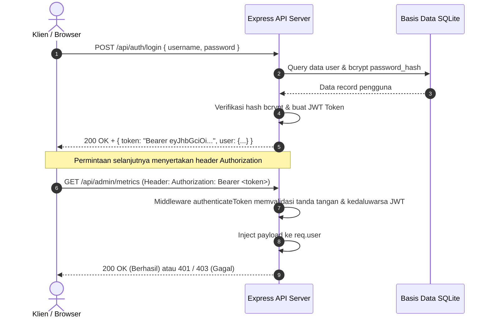
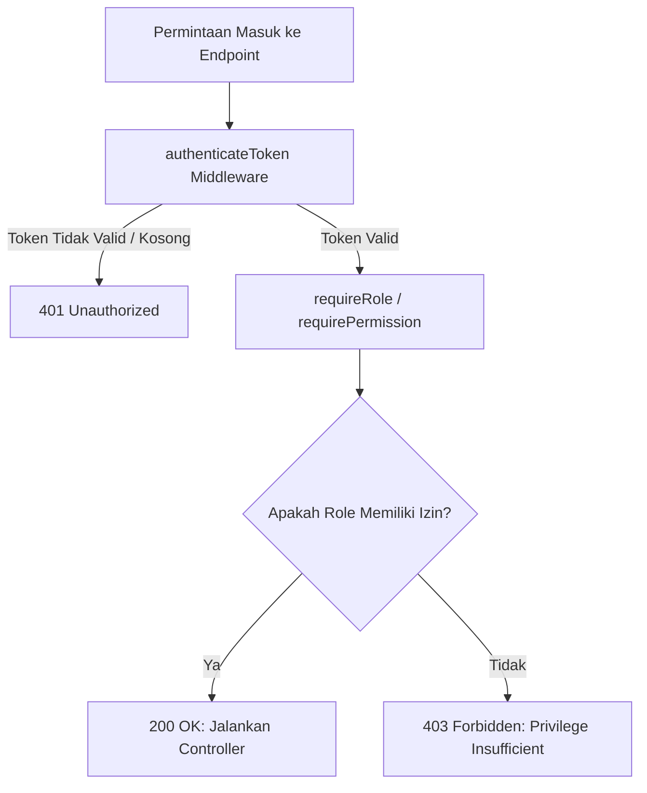
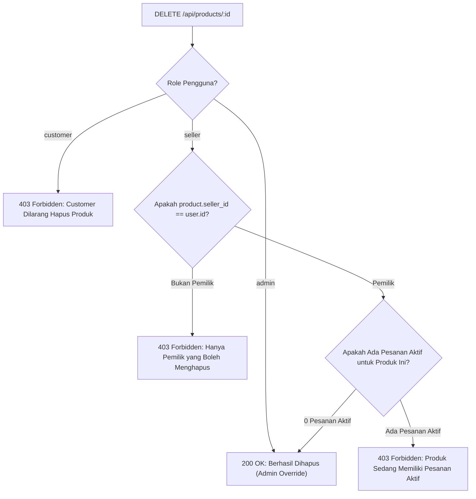

# Toko Ku — E-Commerce Authorization & Security Platform

Platform demonstrasi implementasi sistem keamanan dan kontrol akses modern pada aplikasi web E-Commerce untuk tugas **ALP Cyber Security**. Aplikasi ini mengintegrasikan empat pilar utama kontrol akses: **Access Token (JWT & OAuth 2.0)**, **Role-Based Access Control (RBAC)**, **Attribute-Based Access Control (ABAC)**, dan **Combined Controls (RBAC + ABAC)** dalam satu ekosistem mandiri yang dilengkapi antarmuka web interaktif dan pengujian otomatis terpadu.

---

## Daftar Isi
- [Pilar Keamanan yang Diimplementasikan](#pilar-keamanan-yang-diimplementasikan)
- [Struktur Direktori Proyek](#struktur-direktori-proyek)
- [Panduan Memulai (Quick Start)](#panduan-memulai-quick-start)
- [Peta Navigasi Antarmuka Web](#peta-navigasi-antarmuka-web)
- [Akun Demo & Kredensial](#akun-demo--kredensial)
- [Skenario & Arsitektur Keamanan](#skenario--arsitektur-keamanan)
  - [1. Access Token (JWT & OAuth 2.0)](#1-access-token-jwt--oauth-20)
  - [2. Role-Based Access Control (RBAC)](#2-role-based-access-control-rbac)
  - [3. Attribute-Based Access Control (ABAC)](#3-attribute-based-access-control-abac)
  - [4. Combined RBAC + ABAC](#4-combined-rbac--abac)
- [Katalog Endpoint API](#katalog-endpoint-api)
- [Pengujian Otomatis (Automated Testing)](#pengujian-otomatis-automated-testing)

---

## Pilar Keamanan yang Diimplementasikan

1. **Access Token & Autentikasi Modern**:
   - Penerbitan JSON Web Token (JWT) dengan algoritma `HS256` dan masa berlaku 2 jam.
   - Klaim payload token membawa identitas subjek: `id`, `username`, `email`, `role`, `tier`, dan status `is_verified`.
   - Integrasi Single Sign-On (SSO) Google OAuth 2.0 via Passport.js, dilengkapi endpoint simulasi (Mock OAuth) untuk pengujian instan tanpa dependensi koneksi Google Cloud.
2. **Role-Based Access Control (RBAC)**:
   - Pemisahan hak istimewa berdasarkan hierarki peran: `admin`, `seller`, dan `customer`.
   - Matriks izin granular (`users:manage`, `metrics:view`, `products:create`, dll.) dengan penolakan akses `403 Forbidden` jika peran tidak memadai.
3. **Attribute-Based Access Control (ABAC)**:
   - Evaluasi atribut subjek (pengguna) dan objek (sumber daya) secara dinamis.
   - Pintu gerbang katalog eksklusif VIP berbasis `user.tier === 'vip'`.
   - Perlindungan kepemilikan data pesanan (*order ownership isolation*).
   - Penjagaan siklus hidup transaksi (*order cancellation lifecycle guards*).
4. **Combined Controls (RBAC + ABAC)**:
   - Aturan majemuk (*compound authorization decision*) pada skenario berisiko tinggi.
   - **Penghapusan Produk**: Admin memiliki izin mutlak (RBAC override), sedangkan Seller dibatasi kepemilikan toko dan integritas data pesanan aktif (ABAC constraint).
   - **Persetujuan Refund**: Admin berwenang atas seluruh transaksi, sedangkan Seller dibatasi pada toko milik sendiri serta pagu transaksi maksimal Rp 500.000.

---

## Struktur Direktori Proyek

```
ecommerce-app/
├── data/
│   └── ecommerce.db          # Basis data SQLite lokal
├── public/                   # Antarmuka Web Multi-Halaman
│   ├── index.html            # Storefront Marketplace utama (katalog belanja & filter)
│   ├── dashboard.html        # Interactive Security Lab Matrix & Token Inspector
│   ├── seller.html           # Seller Center (manajemen produk & pesanan per merchant)
│   ├── admin.html            # Panel Administrator (metrik sistem & ringkasan pengguna)
│   ├── login.html            # Portal Autentikasi (login manual, mock Google, real Google)
│   ├── app.js                # Logika client-side HTTP, switcher persona, dan render UI
│   └── style.css             # Desain kustom, styling komponen, dan badge respons status
├── src/
│   ├── config/
│   │   ├── env.js            # Validasi variabel lingkungan (.env)
│   │   └── passport.js       # Strategi Google OAuth 2.0 (Passport.js)
│   ├── db/
│   │   ├── database.js       # Inisialisasi koneksi better-sqlite3 & skema tabel
│   │   └── seed.js           # Seeder data awal akun demo, produk, dan transaksi
│   ├── middleware/
│   │   ├── authenticate.js   # Middleware verifikasi Bearer Token JWT
│   │   └── authorize.js      # Middleware penjaga RBAC & ABAC
│   ├── policies/
│   │   ├── rbac.js           # Definisi matriks peran & pengecekan izin
│   │   ├── abac.js           # Kebijakan atribut produk, pesanan, dan siklus hidup
│   │   └── combined.js       # Kebijakan majemuk penghapusan produk & batas refund
│   ├── routes/
│   │   ├── admin.js          # Rute administratif (metrik & manajemen pengguna)
│   │   ├── auth.js           # Rute registrasi, login, me, dan Google OAuth
│   │   ├── orders.js         # Rute transaksi, detail, pembatalan, & refund
│   │   └── products.js       # Rute katalog, VIP flash deal, kreasi, & hapus produk
│   └── app.js                # Konfigurasi Express, middleware global, & mount API
├── test/
│   ├── db.test.js            # Suite 1: Verifikasi skema, relasi FK, dan CHECK constraint
│   ├── auth.test.js          # Suite 2: Hashing Bcrypt, token JWT, dan Google OAuth
│   ├── rbac.test.js          # Suite 3: Penegakan matriks izin & isolasi rute admin
│   ├── abac.test.js          # Suite 4: Gate VIP tier, kepemilikan data, & pembatalan
│   ├── combined.test.js      # Suite 5: Keputusan majemuk hapus produk & batas refund
│   ├── e2e.test.js           # Suite 6: Pengujian alur integrasi end-to-end lengkap
│   └── runner.js             # Master test runner mandiri tanpa framework eksternal
├── .env.example              # Format konfigurasi variabel lingkungan
├── package.json              # Dependensi pustaka dan script operasional
├── README.md                 # Dokumentasi sistem dan panduan teknis
└── server.js                 # Entry point server HTTP (port 4000)
```

---

## Panduan Memulai (Quick Start)

### 1. Prasyarat Sistem
- **Node.js**: Versi `v18.0.0` atau yang lebih baru.
- **NPM**: Versi bawaan Node.js.

### 2. Salin Konfigurasi Environment
Buat file konfigurasi `.env` dari template yang tersedia:
```bash
# Di Windows PowerShell:
Copy-Item .env.example .env

# Di Linux / macOS:
cp .env.example .env
```

Contoh konfigurasi standar pada `.env`:
```env
PORT=4000
JWT_SECRET=super-secret-jwt-key-for-alp-security-2026
JWT_EXPIRES_IN=2h
GOOGLE_CLIENT_ID=your-google-client-id.apps.googleusercontent.com
GOOGLE_CLIENT_SECRET=your-google-client-secret
CALLBACK_URL=http://localhost:4000/auth/google/callback
```

### 3. Instalasi Dependensi
```bash
npm install
```

### 4. Inisialisasi & Reset Data Awal (Seeding)
Jalankan seeder untuk mengisi database SQLite dengan akun demo, produk katalog, dan riwayat pesanan:
```bash
npm run seed
```

### 5. Eksekusi Pengujian Otomatis
Jalankan test runner terpadu untuk memastikan seluruh logika keamanan lulus 100%:
```bash
npm test
```

### 6. Menjalankan Server Aplikasi
```bash
npm start
```
Server akan aktif pada port `4000`. Akses antarmuka aplikasi melalui browser di: **[http://localhost:4000](http://localhost:4000)**.

---

## Peta Navigasi Antarmuka Web

Aplikasi web dirancang dengan arsitektur multi-halaman untuk mensimulasikan platform E-Commerce nyata:

| Halaman | URL Path | Fungsi & Skenario Pengujian |
| :--- | :--- | :--- |
| **Marketplace Storefront** | [`/`](http://localhost:4000/) | Halaman etalase belanja publik dengan filter kategori, pencarian, banner VIP deals, dan tombol cepat ganti persona. |
| **Security Lab Matrix** | [`/dashboard.html`](http://localhost:4000/dashboard.html) | Laboratorium interaktif khusus pengujian keamanan: memuat Live Token Claims Inspector, tombol eksekusi uji RBAC/ABAC/Combined, dan konsol HTTP log real-time. |
| **Seller Center** | [`/seller.html`](http://localhost:4000/seller.html) | Portal khusus penjual: melihat daftar produk toko sendiri, menambah produk baru, menghapus produk, dan meninjau klaim refund. |
| **Panel Administrator** | [`/admin.html`](http://localhost:4000/admin.html) | Portal khusus manajer sistem: metrik transaksi marketplace, daftar akun pengguna, dan persetujuan refund skala besar. |
| **Portal Autentikasi** | [`/login.html`](http://localhost:4000/login.html) | Halaman login dengan formulir manual, auto-fill akun demo satu-klik, serta tombol simulasi Google OAuth 2.0. |
| **Health Check API** | [`/api/health`](http://localhost:4000/api/health) | Endpoint JSON status kesehatan sistem backend. |

---

## Akun Demo & Kredensial

Sistem menyediakan persona bawaan yang merepresentasikan peran dan kombinasi atribut berbeda:

| Username | Password | Role | Tier | Verified | Skenario Keamanan yang Diuji |
| :--- | :--- | :--- | :--- | :---: | :--- |
| `admin` | `admin123` | `admin` | `regular` | `1` | Memiliki izin global: akses metrik admin, pembacaan seluruh pesanan, bypass batas refund, dan override hapus produk. |
| `seller_tech` | `seller123` | `seller` | `regular` | `1` | Merchant terverifikasi: pemilik Toko Tech (Produk 1 & 2), dapat menyetujui refund toko sendiri $\le$ Rp 500.000. |
| `seller_fashion` | `seller123` | `seller` | `regular` | `0` | Merchant belum terverifikasi: pemilik Toko Fashion (Produk 3 & 4), dibatasi oleh aturan kepemilikan toko. |
| `customer_vip` | `user123` | `customer` | `vip` | `1` | Pembeli prioritas: memenuhi syarat ABAC untuk melihat dan membeli produk VIP Exclusive Flash Deals. |
| `customer_regular`| `user123` | `customer` | `regular` | `1` | Pembeli standar: ditolak (403 Forbidden) saat mengakses katalog VIP; hanya dapat mengelola pesanan sendiri. |
| `Google User` | *OAuth* | `customer` | `regular` | `1` | Akun pelanggan hasil otentikasi Google OAuth 2.0 / Mock Google Instant Login. |

> [!TIP]
> Di setiap halaman web, tersedia bilah navigasi atas (*top bar*) dengan **One-Click Persona Switcher** untuk berpindah identitas secara instan tanpa perlu mengetik ulang kredensial login.

---

## Skenario & Arsitektur Keamanan

### 1. Access Token (JWT & OAuth 2.0)

Autentikasi menggunakan model stateless token berbasis standar JSON Web Token (RFC 7519).



- **Klaim Payload JWT**:
  ```json
  {
    "id": 1,
    "username": "admin",
    "email": "admin@ecommerce.local",
    "role": "admin",
    "tier": "regular",
    "is_verified": 1,
    "iat": 1729400000,
    "exp": 1729407200
  }
  ```
- **Simulasi OAuth (Mock Google)**:
  Endpoint `POST /api/auth/mock-google` memungkinkan simulasi siklus login pihak ketiga tanpa memerlukan kredensial aktif Google Cloud Client ID/Secret.

---

### 2. Role-Based Access Control (RBAC)

RBAC mengatur hak istimewa pengguna berdasarkan peran statis yang ditentukan dalam `src/policies/rbac.js`.



#### Matriks Peran & Hak Akses
| Hak Akses (*Permission*) | `admin` | `seller` | `customer` | Keterangan |
| :--- | :---: | :---: | :---: | :--- |
| `metrics:view` | Ya | Tidak | Tidak | Mengakses metrik penjualan dan performa sistem |
| `users:manage` | Ya | Tidak | Tidak | Mengelola dan meninjau seluruh data pengguna |
| `products:create` | Ya | Ya | Tidak | Menambahkan produk baru ke marketplace |
| `orders:view` | Ya | Ya | Ya | Membaca daftar pesanan (dengan batasan ABAC) |
| `orders:create` | Ya | Tidak | Ya | Membuat pesanan transaksi baru |

---

### 3. Attribute-Based Access Control (ABAC)

ABAC mengevaluasi serangkaian kondisi berbasis konteks subjek dan karakteristik objek secara dinamis pada saat permintaan diproses (`src/policies/abac.js`):

1. **Akses Katalog VIP (`GET /api/products/vip-deals`)**:
   - **Kondisi**: Subjek harus memiliki atribut `user.tier === 'vip'`.
   - **Hasil**: `customer_vip` mendapatkan respons `200 OK`, sedangkan `customer_regular` memperoleh `403 Forbidden` dengan pesan pelanggaran atribut.
2. **Isolasi Visibilitas Pesanan (`GET /api/orders/:id`)**:
   - **Kondisi**: Permintaan hanya diizinkan jika `order.customer_id === user.id` (pembeli pemilik), ATAU `order.seller_id === user.id` (penjual penyedia barang), ATAU `user.role === 'admin'`.
   - **Hasil**: Mencegah kebocoran data transaksi antar pembeli (*horizontal privilege escalation*).
3. **Pembatalan Pesanan (`POST /api/orders/:id/cancel`)**:
   - **Kondisi**: Subjek adalah pembeli pemilik pesanan DAN status pesanan saat ini masih `'pending'`.
   - **Hasil**: Jika pesanan sudah berstatus `'shipped'`, pembatalan ditolak `403 Forbidden` untuk menjaga integritas alur logistik.

---

### 4. Combined RBAC + ABAC

Menggabungkan evaluasi hierarki peran (RBAC) dan aturan atribut kontekstual (ABAC) untuk memitigasi risiko keamanan pada aksi kritis (`src/policies/combined.js`):

#### A. Penghapusan Produk (`DELETE /api/products/:id`)


#### B. Persetujuan Refund Transaksi (`POST /api/orders/:id/approve-refund`)
- **Status Lifecycle**: Pesanan harus berada dalam status `'refund_requested'`.
- **Aturan Evaluasi**:
  - `admin`: Diizinkan secara global untuk nominal pengembalian dana berapa pun.
  - `seller`: Hanya diizinkan JIKA `order.seller_id === user.id` (Toko Sendiri) DAN nilai transaksi `amount <= 500000`. Jika nilai refund melebihi Rp 500.000, aksi ditolak dengan instruksi eskalasi ke Administrator.
  - `customer`: Ditolak `403 Forbidden`.

---

## Katalog Endpoint API

| Method | Endpoint | Otentikasi | Hak Akses / Evaluasi Atribut | Status Berhasil | Status Ditolak |
| :--- | :--- | :---: | :--- | :---: | :---: |
| `POST` | `/api/auth/register` | Publik | Registrasi akun baru (password di-hash Bcrypt) | `201` | `400` |
| `POST` | `/api/auth/login` | Publik | Login pengguna, menghasilkan token JWT | `200` | `401` |
| `GET` | `/api/auth/me` | Bearer Token | Mengambil profil berdasarkan klaim JWT | `200` | `401` |
| `POST` | `/api/auth/mock-google` | Publik | Simulasi instan OAuth Google Customer | `200` | - |
| `GET` | `/api/admin/metrics` | Bearer Token | RBAC: Role `admin` (`metrics:view`) | `200` | `403` |
| `GET` | `/api/admin/users` | Bearer Token | RBAC: Role `admin` (`users:manage`) | `200` | `403` |
| `GET` | `/api/products` | Publik | Menampilkan katalog produk publik non-eksklusif | `200` | - |
| `GET` | `/api/products/vip-deals` | Bearer Token | ABAC: Atribut subjek `user.tier === 'vip'` | `200` | `403` |
| `POST` | `/api/products` | Bearer Token | RBAC: Role `admin` atau `seller` | `201` | `403` |
| `DELETE`| `/api/products/:id` | Bearer Token | Combined: `admin` ATAU (`seller` pemilik + 0 pesanan aktif) | `200` | `403` |
| `GET` | `/api/orders` | Bearer Token | ABAC: Filter dinamis (Customer: miliknya, Seller: tokonya, Admin: semua) | `200` | `401` |
| `GET` | `/api/orders/:id` | Bearer Token | ABAC: Kepemilikan subjek atau peran `admin` | `200` | `403` |
| `POST` | `/api/orders` | Bearer Token | RBAC: Role `customer` atau `admin` | `201` | `403` |
| `POST` | `/api/orders/:id/cancel` | Bearer Token | ABAC: Pemilik pesanan DAN status `'pending'` | `200` | `403` |
| `POST` | `/api/orders/:id/approve-refund` | Bearer Token | Combined: `admin` ATAU (`seller` toko + amount $\le$ 500.000) | `200` | `403` |
| `POST` | `/api/seed` | Publik | Reset database ke kondisi awal (Baseline Seeder) | `200` | `500` |
| `GET` | `/api/health` | Publik | Monitor ketersediaan server API | `200` | - |

---

## Pengujian Otomatis (Automated Testing)

Sistem menyertakan test suite bawaan berbasis assertion engine Node.js mandiri tanpa dependensi runner pihak ketiga.

Jalankan seluruh rangkaian pengujian:
```bash
npm test
```

### Rincian 6 Test Suite (60 Skenario Uji)
1. **Suite 1: Database Schema & Integrity** (`test/db.test.js` — 7 tes):
   - Integritas skema SQLite, penegakan foreign key cascade, dan domain `CHECK` constraint.
2. **Suite 2: Authentication & Token Layer** (`test/auth.test.js` — 8 tes):
   - Penerbitan tanda tangan JWT, parsing token claim, penolakan tampered token, hashing Bcrypt, dan endpoint Mock Google.
3. **Suite 3: Role-Based Access Control** (`test/rbac.test.js` — 10 tes):
   - Pengujian isolasi rute admin, verifikasi penolakan seller & customer, serta pencegahan kebocoran hash password.
4. **Suite 4: Attribute-Based Access Control** (`test/abac.test.js` — 14 tes):
   - Pintu gerbang katalog VIP deals, pembatasan akses histori antar-customer, dan validasi siklus pembatalan order.
5. **Suite 5: Combined Controls** (`test/combined.test.js` — 14 tes):
   - Aturan compound pada penghapusan produk berkendala pesanan aktif dan batas nominal refund per peran.
6. **Suite 6: End-to-End Application & Dashboard** (`test/e2e.test.js` — 7 tes):
   - Boot server HTTP ephemeral, penyajian static multi-halaman web, simulasi 5 user journeys, dan fungsionalitas reset database.

---

## Pemulihan Data (Database Reset)

Untuk mengembalikan seluruh isi data tabel ke kondisi awal seperti saat aplikasi pertama kali dipasang, terdapat 2 cara praktis:
1. **Melalui Antarmuka Web**:
   - Di halaman [Login](http://localhost:4000/login.html) atau [Security Lab](http://localhost:4000/dashboard.html), klik tombol tautan **"Reset Database ke Baseline Awal"**.
2. **Melalui Baris Perintah (Terminal)**:
   ```bash
   npm run seed
   ```
